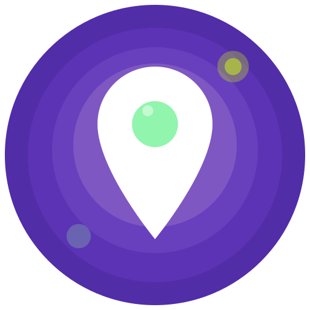

# Shiny KML Recorder

<p align="center">
  
</p>

<p align="center">
  <a href="https://shinyorg.github.io/kmlrecorder/"><strong>🌐 Product website</strong></a> ·
  <a href="#libraries">Libraries</a> ·
  <a href="#testing-without-a-car">Testing without a car</a>
</p>

A .NET MAUI mobile application for iOS and Android that records GPS coordinates and exports them as **KML** or **GeoJSON** files. Track your trips with check-in/check-out sessions, monitor battery and GPS data, and deliver exports via email, Azure Blob Storage, system share, or local storage. Also supports **Apple CarPlay** and **Android Auto** for hands-free recording control.

Plug in an **OBD-II adapter** (Bluetooth LE, classic Bluetooth or WiFi) and it records engine data too — speed, RPM, odometer and 30+ more PIDs — exported as **CSV** or as **KML** with the readings pinned to the track.

**Website:** [shinyorg.github.io/kmlrecorder](https://shinyorg.github.io/kmlrecorder/) — features, screenshots and the tech stack.

## Features

### GPS Tracking
- Real-time GPS listening with high-accuracy requests via Shiny.Locations
- Records latitude, longitude, accuracy, speed (m/s & km/h), and timestamp for each reading
- Android foreground service notification keeps recording active in the background

### Trip Management
- **Check-in** starts a new trip session (generates a unique WorkId)
- **Check-out** ends the current session
- All GPS pings are grouped by trip
- Export filtering by individual trip or all trips at once
- Trip labels display start time, end time, and point count

### Export Formats
- **KML 2.2** — Document structure with styled point placemarks (circle icons, labels) and a track LineString showing the route. Point descriptions include accuracy, speed, battery level, and timestamp.
- **GeoJSON** — FeatureCollection with Point features and a LineString track. Properties include timestamp, accuracy, speed, battery level, battery status, and energy saver state.

### Export Delivery Methods
- **Local** — Save the exported file to the device
- **Email** — Attach the file to an email using the platform email service
- **Share** — Open the system share dialog
- **Azure Blob Storage** — Upload via PUT request with a SAS token (auto-detects content type)

### OBD-II Engine Data
- Scan for and connect to ELM327 / OBDLink adapters over **Bluetooth LE**, **classic Bluetooth** (Android) or **WiFi**, via [Shiny.Obd](https://github.com/shinyorg/obd)
- Reads the vehicle's supported PIDs and VIN on connect; one-tap reconnect to the last adapter with the negotiated protocol pinned
- Choose from 37 PIDs, with a default set of speed, RPM, odometer, coolant temperature, engine load, throttle, fuel level, intake air temperature, module voltage and mass air flow; unsupported PIDs are skipped automatically
- Configurable poll interval; recordings capture the current GPS position with every sample when checked in
- Sessions export as **CSV** (one column per PID) or **KML** (engine readings as ExtendedData on every point), through the same delivery methods as GPS exports

### Battery & System Monitoring
- Tracks battery level, charge state (Charging / Discharging / Not Charging / Full / Unknown), and energy saver status alongside every GPS reading
- GPS permission status displayed on the main screen

### Settings Persistence
- Selected trip, export format, delivery method, Azure credentials, and email settings are saved to app preferences and persist across restarts

### CarPlay & Android Auto
- **Apple CarPlay** — Grid template with a Start/Stop recording button; updates live as recording state changes
- **Android Auto** — Pane template with a Start/Stop action button via AndroidX Car App library

### iOS Home Screen Widget
- **Interactive medium widget** — Displays current tracking status (Recording / Stopped) with elapsed time
- **One-tap toggle** — Start or stop a recording session directly from the home screen
- State shared between the app and widget via App Groups (`group.org.shinylib.kmlrecorder`)
- Widget timeline automatically refreshes when tracking state changes

### Android Home Screen Widget
- **Medium widget** — Displays current tracking status (Recording / Stopped) with elapsed time
- **One-tap toggle** — Tap the play/pause button to open the app and toggle tracking
- Widget automatically refreshes when tracking state changes

### Apple Watch Companion App
- **Native SwiftUI watchOS app** — Shows current tracking status with elapsed time
- **Check In / Check Out button** — Toggle tracking directly from your wrist
- Communicates with iPhone app in real-time via **WatchConnectivity**
- Status updates pushed automatically when tracking state changes on the phone

## Pages

| Page | Description |
|---|---|
| **Main** | GPS recording control — Check-in / Check-out toggle, session status, GPS permission state, navigation to Logs & Settings |
| **Logs** | Displays all recorded GPS points with timestamps, coordinates, accuracy, battery level, and energy saver status |
| **Export** | Shows GPS point count, export status summary, Export Now button, and Open Export Folder |
| **Export Settings** | Configure trip selection, export format (KML / GeoJSON), delivery method, Azure Blob credentials, and email settings; includes a Reset option |
| **Trip Map** | A trip's route on OpenStreetMap (via Mapsui), with start and end markers |
| **OBD** | Choose a transport, scan for adapters, connect, start/stop recording and watch live engine data |
| **OBD Parameters** | Pick the PIDs to record (with per-vehicle support shown once connected) and the poll interval |
| **OBD Sessions** | Recorded engine sessions — export as CSV or KML, or delete |

## Libraries

Every package the app references directly. Exact versions live in [ShinyKmlRecorder.csproj](ShinyKmlRecorder/ShinyKmlRecorder.csproj) (`MauiVersion`, `ShinyVersion` and `ShinyObdVersion` set most of them).

### UI & navigation

| Package | Version | Platforms | Used for |
|---|---|---|---|
| [Microsoft.Maui.Controls](https://www.nuget.org/packages/Microsoft.Maui.Controls) | 10.0.100 | iOS, Android | The .NET MAUI UI framework |
| [Shiny.Maui.Shell](https://www.nuget.org/packages/Shiny.Maui.Shell) | 7.0.3 | iOS, Android | ViewModel-first Shell navigation with source-generated routes (`[ShellMap]`) |
| [Shiny.Maui.Shell.UxDiversDialogs](https://www.nuget.org/packages/Shiny.Maui.Shell.UxDiversDialogs) | 7.0.3 | iOS, Android | Alert, confirm and action-sheet dialogs (built on [UXDivers Popups](https://www.nuget.org/packages/UXDivers.Popups.Maui)) |
| [Shiny.Maui.Controls](https://www.nuget.org/packages/Shiny.Maui.Controls) | 2.5.0 | iOS, Android | `TableView` settings cells (number pickers, switches, buttons) and control feedback |
| [Mapsui.Maui](https://www.nuget.org/packages/Mapsui.Maui) | 5.1.0 | iOS, Android | The trip map, on [OpenStreetMap](https://www.openstreetmap.org/copyright) tiles — no API key. Brings SkiaSharp, BruTile and NetTopologySuite with it |
| [CommunityToolkit.Mvvm](https://www.nuget.org/packages/CommunityToolkit.Mvvm) | 8.4.2 | iOS, Android | `[ObservableProperty]` / `[RelayCommand]` view-model source generators |

### Location, Bluetooth & background

| Package | Version | Platforms | Used for |
|---|---|---|---|
| [Shiny.Locations](https://www.nuget.org/packages/Shiny.Locations) | 6.6.0 | iOS, Android | Background GPS with minimum/maximum distance and time filters (`GpsDelegate`) |
| [Shiny.Hosting.Maui](https://www.nuget.org/packages/Shiny.Hosting.Maui) | 6.6.0 | iOS, Android | Shiny hosting, lifecycle and the Android foreground service |
| [Shiny.BluetoothLE](https://www.nuget.org/packages/Shiny.BluetoothLE) | 6.6.0 | iOS, Android | The BLE radio behind BLE OBD adapters |
| [Shiny.Bluetooth](https://www.nuget.org/packages/Shiny.Bluetooth) | 6.6.0 | Android | Classic Bluetooth (RFCOMM/SPP) for ELM327 v1.5 and OBDLink LX style adapters |

### Vehicle (OBD-II)

| Package | Version | Platforms | Used for |
|---|---|---|---|
| [Shiny.Obd](https://www.nuget.org/packages/Shiny.Obd) | 1.5.1 | iOS, Android | OBD-II commands, ELM327 / OBDLink detection, supported-PID discovery, protocol pinning |
| [Shiny.Obd.Ble](https://www.nuget.org/packages/Shiny.Obd.Ble) | 1.5.1 | iOS, Android | Bluetooth LE adapter transport and scanner |
| [Shiny.Obd.Bluetooth](https://www.nuget.org/packages/Shiny.Obd.Bluetooth) | 1.5.1 | Android | Classic Bluetooth adapter transport and scanner |
| [Shiny.Obd.Wifi](https://www.nuget.org/packages/Shiny.Obd.Wifi) | 1.5.1 | iOS, Android | WiFi (TCP) adapter transport and scanner |

### Data & app plumbing

| Package | Version | Platforms | Used for |
|---|---|---|---|
| [Shiny.DocumentDb.Sqlite](https://www.nuget.org/packages/Shiny.DocumentDb.Sqlite) | 14.2.0 | iOS, Android | On-device document store for GPS logs, OBD sessions and samples (via Microsoft.Data.Sqlite) |
| [SQLitePCLRaw.bundle_e_sqlite3](https://www.nuget.org/packages/SQLitePCLRaw.bundle_e_sqlite3) | 2.1.14 | iOS, Android | Pinned native SQLite — the 2.1.11 that Microsoft.Data.Sqlite pulls in has a known vulnerability ([GHSA-2m69-gcr7-jv3q](https://github.com/advisories/GHSA-2m69-gcr7-jv3q)) |
| [Shiny.Extensions.DependencyInjection](https://www.nuget.org/packages/Shiny.Extensions.DependencyInjection) | 6.0.1 | iOS, Android | Attribute-driven DI registration (`[Singleton]`) with source generators |
| [Shiny.Extensions.Stores](https://www.nuget.org/packages/Shiny.Extensions.Stores) | 6.0.1 | iOS, Android | Persisted settings bound to properties (`[Bind]`) |
| [Shiny.Extensions.Serialization](https://www.nuget.org/packages/Shiny.Extensions.Serialization) | 6.0.1 | iOS, Android | The shared AOT-safe JSON serializer behind the stores |
| [Shiny.Extensions.MauiHosting](https://www.nuget.org/packages/Shiny.Extensions.MauiHosting) | 5.3.1 | iOS, Android | App support services — version info, opening app settings |
| [Microsoft.Extensions.Logging.Debug](https://www.nuget.org/packages/Microsoft.Extensions.Logging.Debug) | 10.0.15 | Debug builds | Debug output logging |

### Android Auto

| Package | Version | Platforms | Used for |
|---|---|---|---|
| [Xamarin.AndroidX.Car.App.App](https://www.nuget.org/packages/Xamarin.AndroidX.Car.App.App) | 1.7.0.4 | Android | The Android Auto recording control |
| [Xamarin.AndroidX.Lifecycle.LiveData.Core](https://www.nuget.org/packages/Xamarin.AndroidX.Lifecycle.LiveData.Core) | 2.11.0.1 | Android | Lifecycle support the Car App library needs |
| [Xamarin.AndroidX.Compose.Runtime.Annotation.Jvm](https://www.nuget.org/packages/Xamarin.AndroidX.Compose.Runtime.Annotation.Jvm) | 1.11.4 | Android | Referenced alongside the Car App library with `ExcludeAssets="all"` — none of its assets ship |

### Native (Swift)

| Framework | Used for |
|---|---|
| CarPlay + MapKit | The CarPlay recording control and its route map |
| WidgetKit + SwiftUI | The iOS home screen widget ([WidgetExtension](WidgetExtension)) |
| WatchConnectivity + SwiftUI | The Apple Watch companion app ([WatchApp](WatchApp)) |

## Testing without a car

You don't need to sit in a car to work on this app. Two tools cover the parts that normally need the road.

### OBD-II: the Shiny.Obd emulator

[Shiny.Obd.Emulator](https://github.com/shinyorg/obd) *is* an OBD-II adapter: an ELM327-compatible bus over TCP (and BLE with `Shiny.Obd.Emulator.Ble`), with eight vehicles whose VINs decode for real and driving scenarios that play changing data into it. KML Recorder connects to it exactly as it would to a real adapter.

- **Easiest:** run the emulator sample app ([samples/Sample.Maui](https://github.com/shinyorg/obd/tree/main/samples/Sample.Maui) in the obd repo) on a second phone, tablet or desktop. It advertises over BLE as `VEEPEAK` and listens on TCP port 35000, so choose **Bluetooth LE** or **WiFi** on the app's OBD page and scan.
- **Headless:** a few lines in a console app on your dev machine. An Android emulator reaches the host at `10.0.2.2`, which the app's WiFi scan finds through the network gateway:

  ```csharp
  using Shiny.Obd.Emulator;

  var config = new ObdEmulatorConfiguration { TcpPort = 35000 };
  var dispatcher = new SynchronizationContextDispatcher(null);
  var state = new ObdEmulatorState { Vehicle = VehicleCatalog.ToyotaCamry };
  var host = new ObdEmulatorHost([new TcpObdServer(new Elm327Responder(state), config)], config, dispatcher);
  await host.Start();

  new DrivingScenarioPlayer(state, dispatcher) { Scenario = DrivingScenarioCatalog.CityDriving }.Start();
  await Task.Delay(Timeout.Infinite);
  ```

  This is how the website's OBD screenshots were taken.
- **Shareable setups:** vehicles, driving scenarios and fault states can live in JSON files described by [obd-emulator.schema.json](obd-emulator.schema.json) (the same schema is published in the obd repo). Load one with `ObdEmulatorProfile.Load(...)` and `ApplyTo(state, player)`.

### GPS: replay a route with MAUI Sherpa

[MAUI Sherpa](https://github.com/redth/MAUI.Sherpa) ([website](https://redth.github.io/MAUI.Sherpa/)) manages your MAUI dev environment, and its device tools include **KML/GPX route playback** onto Android emulators and iOS simulators. That closes the loop nicely: record a real drive with KML Recorder, export it as KML, and replay it into an emulator while you work on the app at your desk.

1. Export a trip from the app as **KML** (or use any KML/GPX route).
2. In MAUI Sherpa, open the emulator or simulator, pick the route file and start playback.
3. Check in on KML Recorder — readings arrive as the route plays, and recording an OBD session against the emulator above gives you GPS-pinned engine data with no car at all.

> **Recent Android emulator images:** route playback on Android uses `adb emu geo fix`. On an API 37 Google Play image it answered `OK` without moving the location; if you see that, drive Android's test location provider instead:
>
> ```bash
> adb shell appops set com.android.shell android:mock_location allow
> adb shell cmd location providers add-test-provider gps
> adb shell cmd location providers set-test-provider-enabled gps true
> adb shell cmd location providers set-test-provider-location gps --location 43.6532,-79.3832 --accuracy 5
> ```

## Website

The product website — [shinyorg.github.io/kmlrecorder](https://shinyorg.github.io/kmlrecorder/) — lives in [website/](website), with its screenshots in [docs/screenshots](docs/screenshots). [.github/workflows/pages.yml](.github/workflows/pages.yml) deploys it to GitHub Pages on every push to `main` that touches the site, the screenshots, `logo.svg` or the ShinySoft logo, and can be run by hand from the Actions tab.

Preview it locally with `website/build.sh --serve` (http://localhost:8080).

## Platform Requirements

- **iOS**: iOS 16.0+
- **Android**: API 26+ (Android 8.0)
- **watchOS**: watchOS 10.0+
- **App ID**: `org.shiny.kmlrecord`

### CarPlay Setup

1. Enable the **Driving Task** CarPlay capability for your App ID (`org.shiny.kmlrecord`) in the [Apple Developer Portal](https://developer.apple.com/account/resources/identifiers/list)
2. The project includes `CarPlaySceneDelegate` and the required `Info.plist` scene manifest configuration
3. Custom entitlements for `com.apple.developer.carplay-driving-task` are set in the `.csproj`

### iOS Widget Setup

1. Enable the **App Groups** capability for your App ID in the [Apple Developer Portal](https://developer.apple.com/account/resources/identifiers/list) and add `group.org.shinylib.kmlrecorder`
2. The widget extension is a native Swift/SwiftUI project located in `WidgetExtension/`
3. The `.csproj` includes MSBuild targets that build the widget extension and bundle it automatically during iOS builds
4. The widget uses the `kmlrecorder://toggle` URL scheme to open the app and toggle tracking

### watchOS App Setup

1. The watchOS companion app is a native SwiftUI project located in `WatchApp/`
2. The `.csproj` includes an MSBuild target that builds the watchOS app during iOS builds
3. The iPhone app starts a `WCSession` in the AppDelegate to handle messages from the watch
4. The watch app bundle identifier must be `org.shiny.kmlrecorder.watchapp` with companion app identifier `org.shiny.kmlrecorder`